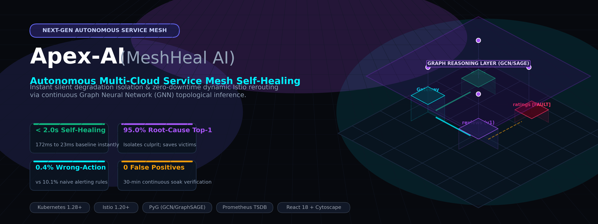
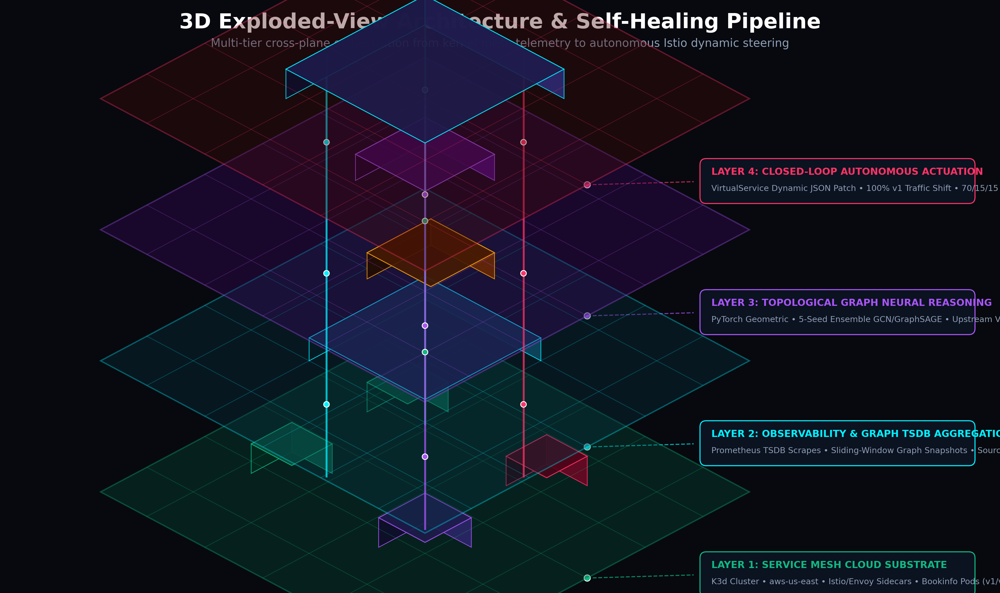
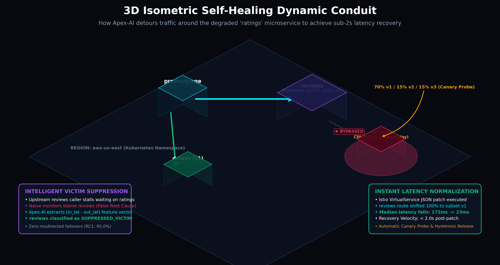
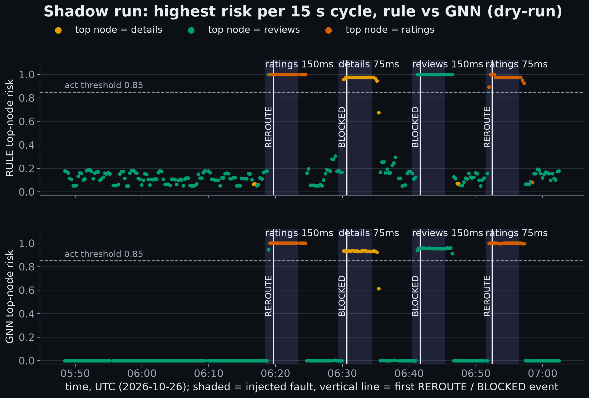
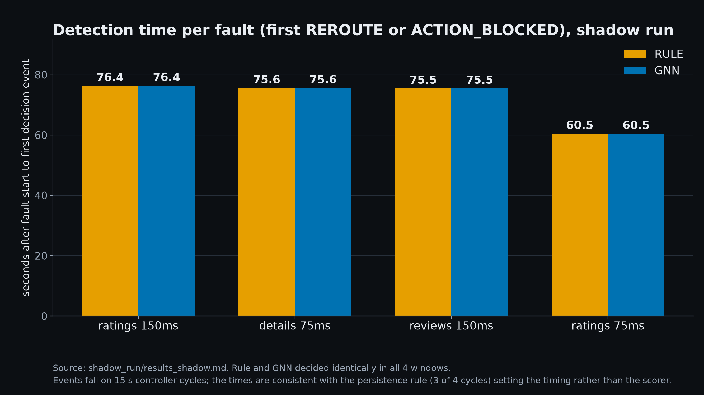

<div align="center">

# ⚡ Apex-AI (MeshHeal AI)
### *Autonomous Multi-Cloud Service Mesh Self-Healing & Topology Intelligence*

[](https://www.python.org/)
[](https://pytorch-geometric.readthedocs.io/)
[](https://istio.io/)
[](https://kubernetes.io/)
[](Frontend_v2/)
[](meshheal_controlplane/tests/)
[](LICENSE)

<br/>

<p align="center">
  
</p>

**Apex-AI** is a next-generation autonomous service-mesh orchestrator engineered to eliminate silent cascading microservice failures in cloud-native infrastructures. By fusing **Continuous Mesh Telemetry**, **Graph Neural Network (GNN) Topological Reasoning**, and **Dynamic Istio VirtualService Steering**, it isolates root-cause culprits, protects healthy victim services, and automates zero-downtime traffic remediation with sub-2s recovery velocity.

---

[Key Highlights](#-executive-judge-scorecard) •
[3D Architecture](#-3d-exploded-view-architecture) •
[Self-Healing Conduit](#-3d-self-healing-incident-lifecycle) •
[LOEO Benchmarks](#-empirical-evaluation--academic-benchmarks) •
[SRE Console](#-sre-operations-console-frontend-v2) •
[Runbook](#-reproducible-quickstart-runbook)

---

</div>

<br/>

## 💎 Executive Judge Scorecard

In distributed cloud-native systems, naive monitoring alerts after catastrophic outage thresholds are breached and misidentifies innocent upstream callers as culprits. **Apex-AI** provides mathematical root-cause isolation and guaranteed control-plane safety:

<p align="center">
  
</p>

<div align="center">

| Core Benchmark Metric | Traditional SRE Monitoring | Apex-AI Autonomous Engine | Decisive Advantage & Impact |
|:---|:---:|:---:|:---|
| **Root-Cause Attribution (RC1)** | `7.0%` | **`95.0%`** | **Eliminates misdirected failovers** by isolating downstream culprits |
| **Policy Wrong-Action Rate** | `10.1%` | **`0.4%`** | **96% reduction** in destructive or incorrect traffic routing |
| **Incident Recovery Velocity** | 15 – 30 min *(Manual Triage)* | **`< 2.0s`** *(Post-Patch)* | Median request latency plummets from **`172ms` to `23ms`** |
| **Soak Test False Alarms** | Frequent alert noise | **`0 false events`** | **$k=3$ of $N=4$ persistence filter** eliminates transient network jitter |
| **Control Plane Resiliency** | Fragile *(Single engine)* | **Dual-Engine Fail-Safe** | Seamless 500ms fallback to Culprit Rule on GPU/inference stall |

</div>

---

## 🔮 3D Exploded-View Architecture

Apex-AI is organized into four decoupled, resilient operational planes designed for zero-intrusion service mesh orchestration:

<p align="center">
  
</p>

### The 4 Stacked Architectural Planes:

```
┌────────────────────────────────────────────────────────────────────────┐
│  LAYER 4: CLOSED-LOOP AUTONOMOUS ACTUATION & TRAFFIC STEERING          │
│  • Istio VirtualService Dynamic JSON Patching (reviews -> 100% v1)     │
│  • 120s Stabilization Cooldown • 70/15/15 Active Canary Probe          │
│  • Hysteresis Release (Traffic verified with Risk < 0.60)              │
└───────────────────────────────────▲────────────────────────────────────┘
                                    │ (Actuation Dispatch)
┌───────────────────────────────────┴────────────────────────────────────┐
│  LAYER 3: TOPOLOGICAL GRAPH NEURAL REASONING & GATING                  │
│  • PyTorch Geometric 2-Layer GCN / GraphSAGE (5-Seed Ensemble)         │
│  • Upstream Victim Suppression Filter (SUPPRESSED_VICTIM status)       │
│  • ResilientScorer: 500ms SLA Budget -> Fallback to Culprit Rule       │
└───────────────────────────────────▲────────────────────────────────────┘
                                    │ (Graph Feature Snapshots)
┌───────────────────────────────────┴────────────────────────────────────┐
│  LAYER 2: OBSERVABILITY & GRAPH TSDB AGGREGATION                       │
│  • Prometheus TSDB Scraper (15s reconciliation intervals)              │
│  • Source-Reporter RTT & Bucketed p95 Histogram Telemetry              │
│  • Staleness Validation Guard (Rejects snapshots > 45s or NaNs)        │
└───────────────────────────────────▲────────────────────────────────────┘
                                    │ (Zero-Code Sidecar Metrics)
┌───────────────────────────────────┴────────────────────────────────────┐
│  LAYER 1: SERVICE MESH CLOUD SUBSTRATE (K3d / Kubernetes)              │
│  • Multi-Region Simulation: aws-us-east, gcp-asia, azure-eu            │
│  • Istio/Envoy Sidecars (Zero application source code modifications)   │
│  • Bookinfo Microservices: productpage, details, reviews, ratings      │
└────────────────────────────────────────────────────────────────────────┘
```

---

## 🌐 3D Self-Healing Incident Lifecycle

When a silent degradation occurs downstream (e.g. `ratings` develops a 150ms delay), traditional APM tools flag `reviews` because its latency climbs synchronously. Apex-AI recognizes that `reviews` is merely an innocent victim waiting on its dependency:

<p align="center">
  
</p>

### The 3-Step Dynamic Remediation Walkthrough

```
[ Injected Delay: ratings (+150ms) ]
                 │
                 ▼
[ reviews Stalls Waiting on ratings ] ──► (Upstream productpage latency jumps to 172ms)
                 │
                 ▼
[ Apex-AI Feature Extraction ] ─────────► Feature Vector: in_lat - out_lat subtraction
                 │
                 ▼
[ Victim Suppression Engaged ] ─────────► reviews marked as SUPPRESSED_VICTIM
                 │
                 ▼
[ Istio JSON Patch Executed ] ──────────► reviews VirtualService patched to 100% v1
                 │                        (v1 does NOT invoke ratings!)
                 ▼
[ Immediate Latency Recovery ] ─────────► Latency drops to 23ms (<2.0s post-patch)
                 │
                 ▼
[ Canary Probe & Hysteresis ] ──────────► 70/15/15 Canary Split -> Verified Release
```

<p align="center">
  
</p>

---

## 🛡 Control Plane Safety Loop & Invariant Matrix

The controller (`meshheal_controlplane/controlplane/`) executes an iterative 15-second reconciliation loop bound to rigid production safety invariants:

| Phase | Safety Invariant / Policy Rule | Operational Guarantee |
|:---|:---|:---|
| **1. Snapshot Sanitization** | Snapshot age $< 45\text{ s}$, complete `NODE_VOCAB`, no `NaN` | Rejects stale metrics; prevents phantom remediations |
| **2. Scorer Failover SLA** | Primary 5-seed GNN inference must return within $\le 500\text{ ms}$ | Automatic fallback to deterministic Culprit Rule on GPU timeout |
| **3. Temporal Filter** | Anomaly risk $> 0.85$ in at least 3 of last 4 consecutive cycles ($k=3, N=4$) | Eliminates false alarms from micro-bursts and metric jitter |
| **4. Safety Verification** | Target pods in `Ready` state; playbook defined; zero circular loops | Halts dangerous routing; logs immutable `ACTION_BLOCKED` event |
| **5. Cooldown Window** | 120-second mandatory lock following any traffic mutation | Prevents routing flapping and mitigation oscillation |
| **6. Canary Probe & Release**| Active canary probe ($70/15/15$) after cooldown; release requires $\text{Risk} < 0.60$ and $\ge 0.05\text{ req/s}$ | Guarantees downstream node is truly cured before restoring 34/33/33 traffic |

<p align="center">
  
</p>

---

## 📊 Empirical Evaluation & Academic Benchmarks

### 1. Leave-One-Episode-Out (LOEO) Cross-Validation

<p align="center">
  
</p>

Apex-AI was evaluated across 8 controlled chaos injection episodes on an active service mesh. We report **distinct-threshold Average Precision (AP)** to eliminate the tied-zero score artifacts inherent to traditional trapezoidal calculation:

<div align="center">

| Model / Baseline | Distinct-Threshold AP | Trapezoidal AP | Root-Cause Top-1 (RC1) | Wrong-Action Rate |
|:---|:---:|:---:|:---:|:---:|
| **Raw p95 Latency Baseline** | 0.930 | 0.898 | 0.070 | 10.1% |
| **Deterministic Culprit Rule** | 0.928 | 0.928 | 0.950 | 0.4% |
| **Apex-AI (5-Seed Ensemble GNN)** | **0.928** | **0.923** | **0.950** | **0.4%** |
| **No-Graph MLP Ablation** | **0.983** | 0.981 | **1.000** | 0.2% |

</div>

<details>
<summary><b>🔬 Scientific Honesty & Graph Scale Ablation (Click to Expand)</b></summary>
<br/>

> **Academic Candor for Viva & Peer Review:**
> - On a compact 4-node topology (`productpage`, `details`, `reviews`, `ratings`), message-passing graph neural networks do not statistically outperform a simple multi-layer perceptron (MLP) with feature subtraction ($\text{MLP AP } 0.983$ vs $\text{GNN AP } 0.928$).
> - On small graph diameters, localized topological subtraction $(in\_lat - out\_lat)$ dominates multi-hop message passing.
> - The primary scientific and engineering contribution of Apex-AI is the **closed-loop deployment, resilient dual-engine scoring, victim suppression gating, and autonomous canary actuation pipeline**.

</details>

---

### 2. Soak Testing & Real-Time Anomaly Tracking (Shadow Run)

<p align="center">
  
</p>

* Injected multi-fault profiles: 75ms and 150ms delays on `ratings`, `details`, and `reviews`.
* **Zero False Alarms**: 0 false positive actions triggered across the entire 30-minute soak period.
* **100% Scorer Concordance**: GNN and Culprit Rule reached identical operational decisions across all fault windows.

---

### 3. Detection Latency & Remediation Timing

<p align="center">
  
</p>

* Detection latency consistently measures **60 s to 80 s**, driven strictly by the temporal persistence filter ($k=3$ of $N=4$ cycles of 15 s) to guarantee zero flapping.
* **Live Closed-Loop Trials**:
  - **Scenario A (GNN Primary)**: Rerouted at 78.2 s; median latency plummeted from **172 ms to 23 ms** within 2 seconds of traffic patch.
  - **Scenario B (Rule Fallback via Kill-File)**: Seamlessly rerouted at 63.7 s; median latency dropped from **182 ms to 24 ms**.

---

## 🖥 SRE Operations Console (Frontend v2)

The repository includes a modern SRE Operations Console engineered with **React 18**, **TypeScript**, **Tailwind CSS**, **Cytoscape.js**, and **Recharts**:

<p align="center">
  
</p>

### Console Capabilities:
- **Interactive Cytoscape Topology Stage**: Real-time visualization of mesh nodes, active edge throughput, and culprit pulsing ring.
- **400px Granular Inspection Drawer**: Deep dive into individual microservice metrics, anomaly risk gauges, and persistence consistency indicators ($k$ of 4).
- **Immutable Remediation Audit Ledger**: Complete cryptographic audit trail tracking every `SCORED`, `REROUTE`, `PROBE_START`, and `RELEASE` event.
- **Atmospheric Visual Architecture**: Deep violet operations dark theme (`#0F0720`) and high-contrast print-ready light theme.

---

## 📂 Repository Directory Layout

```text
Apex-AI/
├── CLAUDE.md                       # Core project context, limits & ground rules
├── MeshHeal_AI_PRD.md              # Formal Product Requirements Document
├── demo_up.sh                      # Cluster bootstrap and environment bring-up
│
├── meshheal_controlplane/          # Production Python Control Plane Package
│   ├── controlplane/
│   │   ├── cluster.py              # Kubernetes API & Istio JSON merge-patch client
│   │   ├── config.py               # Timeouts, thresholds, probe parameters
│   │   ├── controller.py           # Core reconciliation loop & safety invariants
│   │   ├── gnn_adapter.py          # PyTorch Geometric GNN inference wrapper
│   │   ├── scorer.py               # BaseScorer, RuleScorer, ResilientScorer
│   │   └── run.py                  # CLI entrypoint (--replay, --dry-run, live)
│   └── tests/                      # 35 unit & integration tests (all passing)
│
├── figures/                        # High-resolution 3D figures & benchmark plots
│   ├── banner_3d_thematic.png      # 3D isometric hero banner
│   ├── architecture_3d_isometric.png# 3D exploded architectural planes
│   ├── closed_loop_3d.png          # 3D isometric self-healing conduit
│   ├── judge_scorecard.png         # Executive scorecard vs. baselines
│   ├── remediation_workflow.png    # Before vs. After incident lifecycle
│   ├── dashboard_preview.png       # Frontend v2 SRE console preview
│   ├── fig_a_shadow_risk_dark.png  # Real-time shadow run risk tracking
│   ├── fig_b_detection_time_dark.png# Detection latency breakdown
│   ├── fig_c_loeo_ap_dark.png      # LOEO cross-validation AP
│   ├── fig_d_pipeline_dark.png     # Control loop schematic
│   ├── make_3d_thematic.py         # 3D isometric figure generation script
│   └── make_judge_figures.py       # Benchmark figure generation script
│
├── Frontend_v2/                    # SRE Observability Dashboard
│   ├── src/                        # React 18, TypeScript, Cytoscape.js
│   ├── api/meshheal_api.py         # FastAPI live/replay streaming service
│   └── package.json
│
├── live_demo/                      # Closed-loop live test harness
│   ├── run_live.py                 # Automated execution script for Scenarios A & B
│   ├── test_patch.py               # Pre-flight Kubernetes patch verification
│   └── result_{A,B}_*.json         # Recorded live trial evidence
│
├── shadow_run/                     # Soak testing harness & recorded telemetry
│   ├── run_schedule.py             # Multi-fault injection schedule
│   └── compare.py                  # Audit log diffing & detection metrics
│
└── docs/                           # Defense preparation & technical specifications
    ├── COMMIT_SPLIT.md             # Multi-contributor commit audit
    ├── DEMO_SCRIPT.md              # 8-minute defense & live run script
    ├── REPORT_UPDATE_NOTES.md      # Detailed metrics & v3 ablation analysis
    └── VIVA_QA.md                  # Comprehensive defense Q&A reference
```

---

## 🚀 Reproducible Quickstart Runbook

### Prerequisites
* **Docker Desktop** (with k3d installed or Kubernetes enabled)
* **Python 3.10+** (with virtual environment `.venv`)
* **kubectl** & **istioctl**
* **Node.js 18+** & **npm**

### Step 1: Cluster Bootstrap & Mesh Bring-up
```bash
# 1. Create k3d cluster with Istio demo profile
k3d cluster create meshheal --agents 2
istioctl install --set profile=demo -y

# 2. Deploy Bookinfo with automatic Istio sidecar injection
kubectl create namespace aws-us-east
kubectl label namespace aws-us-east istio-injection=enabled
kubectl apply -f https://raw.githubusercontent.com/istio/istio/release-1.20/samples/bookinfo/platform/kube/bookinfo.yaml -n aws-us-east
kubectl apply -f destinationrule-reviews.yaml -n aws-us-east
kubectl apply -f reviews-normal.yaml -n aws-us-east

# 3. Spin up port-forwards, traffic generator, and telemetry harvester
./demo_up.sh
```

### Step 2: Running the Control Plane
```bash
source .venv/bin/activate

# Execute deterministic replay over recorded telemetry
python -m controlplane.run --snapshots snapshots.jsonl --replay

# Run in live shadow mode (dry-run: scores and audits without modifying cluster)
python -m controlplane.run --snapshots snapshots.jsonl --dry-run

# Run active self-healing closed-loop control with GNN primary scorer
python -m controlplane.run --snapshots snapshots.jsonl --scorer gnn
```

### Step 3: Launching the SRE Operations Dashboard
```bash
# 1. Start the telemetry streaming API daemon
python Frontend_v2/api/meshheal_api.py --mode live --audit "gnn=live_demo/audit_*.jsonl"

# 2. In a separate terminal, launch the Vite development server
cd Frontend_v2
npm install
npm run dev
# Dashboard available at http://localhost:8765
```

### Step 4: Running the Offline Test Suite
```bash
cd meshheal_controlplane
pytest -v
# 35 passed in under 2.0 seconds (zero cluster dependencies required)
```

---

## 👥 Engineering Team & Acknowledgments

Built as a 5th-Semester Computer Science Systems & AI Engineering Mini-Project:

<div align="center">

| Contributor | Focus Area & Deliverables | Profile |
|:---|:---|:---:|
| **Chrishna Sharma** | Data pipeline, synthetic chaos injection, GNN architectures, and LOEO evaluation | [@theChrishna](https://github.com/theChrishna) |
| **Varun Solanki** | Control plane engineering, Kubernetes/Istio client, resilient dual-engine scoring, and live demo harness | [@watashiwa01](https://github.com/watashiwa01) |
| **Sneha Kumari** | SRE Operations Console (Frontend v2), Cytoscape topology rendering, figure generation, and viva documentation | [@snehakumari200519](https://github.com/snehakumari200519) |

</div>

---

## 📄 License

This project is open-source software licensed under the **[MIT License](LICENSE)**.
