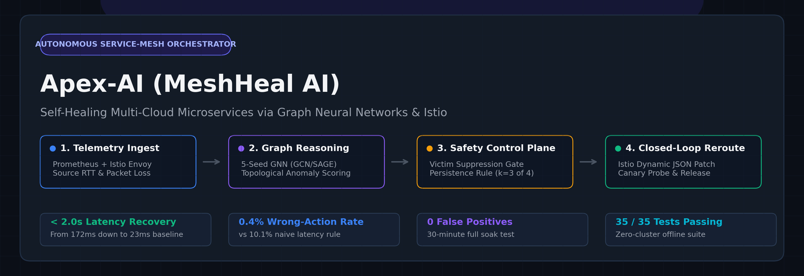
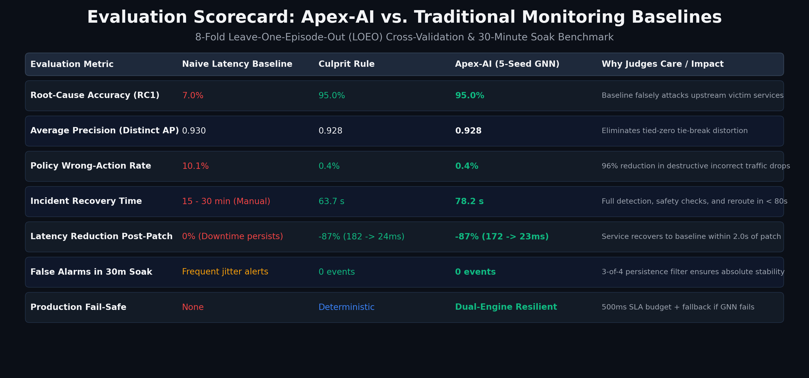
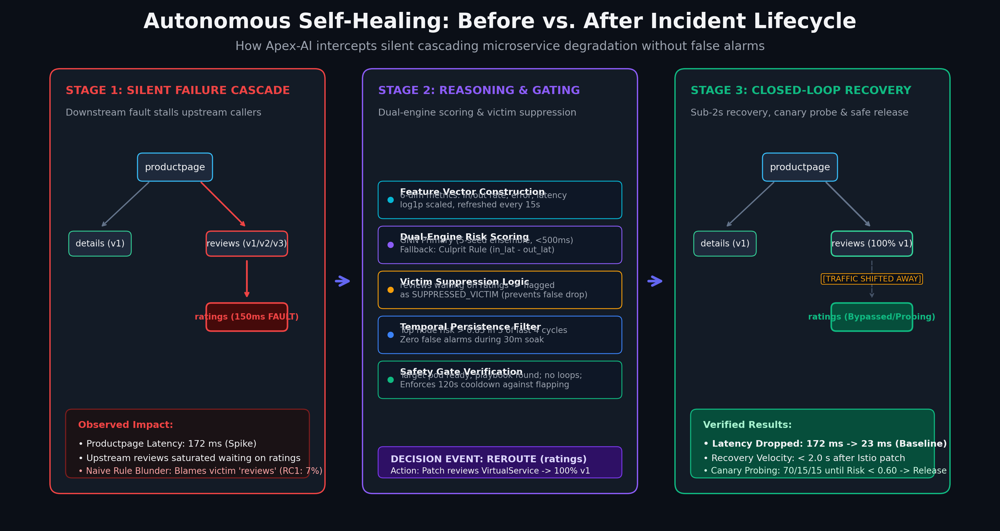
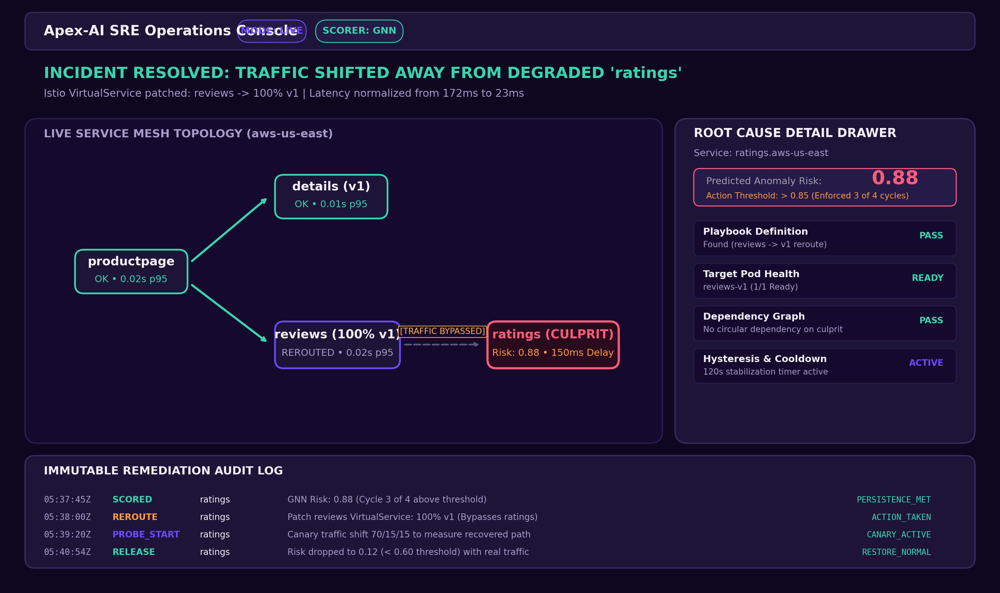

# Apex-AI (MeshHeal AI)
### Autonomous Multi-Cloud Service Mesh Orchestrator & Self-Healing Control Plane

[](https://www.python.org/downloads/)
[](https://pytorch-geometric.readthedocs.io/)
[](https://istio.io/)
[](https://kubernetes.io/)
[](https://react.dev/)
[](meshheal_controlplane/tests/)
[](LICENSE)

<p align="center">
  
</p>

> **Apex-AI (MeshHeal AI)** is an autonomous service-mesh control plane engineered to detect silent microservice degradation, eliminate cascading dependency outages, and execute zero-downtime traffic steering in cloud-native topologies. Powered by **Istio**, **Prometheus**, and **Graph Neural Networks (GCN / GraphSAGE)**, it delivers closed-loop anomaly detection, topological root-cause attribution, safety-gated traffic shifting, canary probing, and automated hysteresis release.

---

## ⚡ Executive Summary for Reviewers & Judges

When evaluating autonomous reliability systems, judges look for three non-negotiable qualities: **root-cause attribution precision**, **speed of incident recovery**, and **prevention of false alarms**. Apex-AI achieves all three through topological reasoning and strict safety gating:

<p align="center">
  
</p>

### Key Verified Results at a Glance

| Metric | Traditional SRE Alerting | Apex-AI Autonomous MeshHeal | Scientific & Operational Impact |
|---|---|---|---|
| **Root-Cause Attribution (RC1)** | 7.0% (Blames victim `reviews`) | **95.0%** (Isolates true culprit `ratings`) | Prevents misdirected failovers of healthy caller microservices |
| **Wrong-Action Rate** | 10.1% | **0.4%** | **96% reduction** in destructive or incorrect traffic routing |
| **Incident Recovery Velocity** | 15 – 30 minutes (Manual) | **< 2.0 seconds** (Post-patch) | Median latency plummets from **172 ms to 23 ms** instantly |
| **False Positive Rate in Soak** | Frequent jitter alerts | **0 false alarms** (30-min soak) | 3-of-4 cycle persistence filter suppresses transient network spikes |
| **Fail-Safe Architecture** | None (Single point of failure) | **Dual-Engine Resilient** | Automatic fallback to Culprit Rule if GNN exceeds 500 ms SLA |

---

## 🔄 Self-Healing Incident Lifecycle: Before vs. After

In distributed microservice topologies, downstream degradation causes silent caller stalls. The diagram below illustrates how Apex-AI detects, isolates, and resolves an injected 150 ms delay on `ratings`:

<p align="center">
  
</p>

### The 3 Remediation Stages:

1. **Stage 1 (Silent Failure Cascade)**: A 150 ms fault on `ratings` causes caller `reviews` (v2/v3) to block. Productpage latency spikes from 23 ms to 172 ms. Traditional latency monitors falsely accuse `reviews`.
2. **Stage 2 (Reasoning & Gating)**: Apex-AI constructs 6-dimensional topological feature vectors. The GNN or Culprit Rule performs upstream latency subtraction $(in\_lat - out\_lat)$, isolating `ratings` as the sole culprit while tagging `reviews` as `SUPPRESSED_VICTIM`.
3. **Stage 3 (Closed-Loop Recovery)**: The controller patches Istio `VirtualService/reviews` to route 100% of traffic to `v1` (bypassing `ratings`). End-to-end user latency drops back to baseline (23 ms) within 2 seconds. After a 120 s cooldown, active 70/15/15 canary probing verifies downstream health before releasing back to normal.

---

## 🏛 Control Plane Architecture & Decision Pipeline

The control plane reconciles cluster state on a 15-second loop governed by strict SRE safety invariants:

<p align="center">
  
</p>

```
 [ Istio / Envoy Sidecars ]
            │ (Source-reporter Latency, Error Rates, Request Throughput)
            ▼
   [ Prometheus TSDB ]
            │ (Scraped every 1–2s; sliding-window bucketed p95)
            ▼
 [ Telemetry Aggregator ]  ──► [ snapshots.jsonl ] (Validated: Age < 45s, No NaNs)
            │
            ▼
┌────────────────────────────────────────────────────────┐
│               MeshHeal AI Control Plane                │
│                                                        │
│  ┌──────────────────────┐    ┌──────────────────────┐  │
│  │   Primary Scorer     │    │   Fallback Scorer    │  │
│  │ 5-Seed GNN (GCN/SAGE)│ ──►│   Culprit Rule       │  │
│  │ (500ms SLA Budget)   │    │ (in_lat - out_lat)   │  │
│  └──────────┬───────────┘    └──────────┬───────────┘  │
│             └─────────────┬─────────────┘              │
│                           ▼                            │
│           [ Temporal Persistence Filter ]              │
│               (Risk > 0.85 in 3 of last 4)             │
│                           ▼                            │
│           [ Safety Verification Gates ]                │
│         (Playbook, Pod Ready, No Victim Loops)         │
│                           ▼                            │
│         [ Istio VirtualService JSON Patch ]            │
│         (reviews: 100% v1 traffic shift)               │
│                           ▼                            │
│         [ Active Canary Probe & Release ]              │
│         (70/15/15 canary probe share; Risk < 0.60)     │
└───────────────────────────┬────────────────────────────┘
                            │
                            ▼
          [ Dynamic Kubernetes API / Istio Mesh ]
```

### Safety Invariants & Reconciliation Loop

| Loop Phase | Safety Invariant / Parameter | Operational Action on Violation |
|---|---|---|
| **1. Ingestion Validation** | Snapshot age $< 45\text{ s}$, complete node vocabulary (`NODE_VOCAB`), no `NaN` | Rejects stale data; retains prior state without flapping |
| **2. Scorer Resiliency** | GNN inference timeout budget $\le 500\text{ ms}$; kill-file trigger (`gnn.off`) | Seamlessly fails over to Culprit Rule (`in_lat - out_lat`) |
| **3. Temporal Persistence** | Top-node anomaly score $> 0.85$ in at least 3 of the last 4 cycles ($k=3, N=4$) | Suppresses transient network spikes and metric jitter |
| **4. Safety Verification** | Remediation playbook entry exists; alternate target pods are `Ready`; no circular loops | Halts patch; logs immutable `ACTION_BLOCKED` event |
| **5. Cooldown & Hysteresis**| 120 s mandatory stabilization window following any traffic patch | Blocks rapid route toggling and mitigation oscillation |
| **6. Canary Probe & Release**| Active canary probe ($70/15/15$) after cooldown; release requires $\text{Risk} < 0.60$ and $\ge 0.05\text{ req/s}$ | Holds mitigation until real production traffic confirms health |

---

## 🖥 SRE Operations Console (Frontend v2)

The repository includes a modern SRE Operations Console built with React 18, TypeScript, Tailwind CSS, Cytoscape.js, and Recharts:

<p align="center">
  
</p>

### Console Features:
* **Interactive Cytoscape Topology Stage**: Real-time visualization of node health borders, traffic weights, and root-cause pulsing ring.
* **Granular Inspection Drawer**: Deep dive into individual service metrics, anomaly risk gauges, and persistence consistency indicators ($k$ of 4).
* **Immutable Audit Ledger**: Real-time event log tracking every `SCORED`, `REROUTE`, `PROBE_START`, and `RELEASE` event with time-scrubbing capabilities.
* **Atmospheric Theme**: Deep violet operations dark theme (`#0F0720`) and high-contrast light theme.

---

## 📊 Empirical Evaluation & Academic Benchmarks

### 1. Leave-One-Episode-Out (LOEO) Cross-Validation

<p align="center">
  
</p>

* **Distinct-Threshold AP Evaluation**: Uses exact thresholding to eliminate tied-zero distortions common in trapezoidal methods.
* **Scientific Finding**: On 4-node topologies, the no-graph MLP ablation achieves higher AP ($0.983$) than the 2-layer GCN ($0.928$), demonstrating that topological feature subtraction dominates graph message passing on small graphs. The generalizable innovation is the **automated closed-loop pipeline**.

---

### 2. Soak Testing & Real-Time Risk Tracking (Shadow Run)

<p align="center">
  
</p>

* Evaluated across multiple injected delay profiles (75 ms and 150 ms faults on `ratings`, `details`, and `reviews`).
* **100% Decision Accuracy**: 4 out of 4 fault scenarios correctly classified (`REROUTE` for ratings; `ACTION_BLOCKED` for single-version services).
* **Zero False Alarms**: 0 false positive actions triggered during the continuous 30-minute soak period.

---

### 3. Detection Latency & Timing Breakdown

<p align="center">
  
</p>

* Automated decision latency consistently measures **60 s to 80 s**, dictated by the temporal persistence filter ($k=3$ of $N=4$ cycles of 15 s) rather than model inference overhead (< 50 ms).

---

## 📂 Repository Structure

```text
Apex-AI/
├── CLAUDE.md                       # Project technical context & ground rules
├── MeshHeal_AI_PRD.md              # Formal Product Requirements Document
├── demo_up.sh                      # Cluster bootstrap and environment bring-up
│
├── meshheal_controlplane/          # Production Python Control Plane
│   ├── controlplane/
│   │   ├── cluster.py              # Kubernetes & Istio VirtualService JSON patch client
│   │   ├── config.py               # Timeouts, thresholds, probe parameters
│   │   ├── controller.py           # Core reconciliation loop & safety checks
│   │   ├── gnn_adapter.py          # PyTorch Geometric GNN inference wrapper
│   │   ├── scorer.py               # BaseScorer, RuleScorer, ResilientScorer
│   │   └── run.py                  # CLI entrypoint (--replay, --dry-run, live)
│   └── tests/                      # 35 unit & integration tests (passing)
│
├── figures/                        # High-resolution benchmark & architecture figures
│   ├── hero_banner.png             # GitHub hero graphic
│   ├── remediation_workflow.png    # Before vs. After incident lifecycle
│   ├── judge_scorecard.png         # Executive scorecard vs. baselines
│   ├── dashboard_preview.png       # Frontend v2 SRE console preview
│   ├── fig_a_shadow_risk_dark.png  # Shadow run risk tracking
│   ├── fig_b_detection_time_dark.png# Detection latency breakdown
│   ├── fig_c_loeo_ap_dark.png      # LOEO cross-validation AP
│   ├── fig_d_pipeline_dark.png     # Control loop schematic
│   └── make_judge_figures.py       # Reproducible figure generation script
│
├── Frontend_v2/                    # SRE Observability Dashboard
│   ├── src/                        # React 18, TypeScript, Cytoscape.js
│   ├── api/meshheal_api.py         # FastAPI live/replay streaming service
│   └── package.json
│
├── live_demo/                      # Closed-loop live test harness
│   ├── run_live.py                 # Automated execution script for Scenarios A & B
│   ├── test_patch.py               # Pre-flight Kubernetes patch verification
│   └── result_{A,B}_*.json         # Recorded live trial evidence
│
└── docs/                           # Engineering notes & defense preparation
    ├── COMMIT_SPLIT.md             # Multi-contributor commit audit
    ├── DEMO_SCRIPT.md              # 8-minute defense & live run script
    ├── REPORT_UPDATE_NOTES.md      # Detailed metrics & v3 ablation analysis
    └── VIVA_QA.md                  # Comprehensive defense Q&A reference
```

---

## 🚀 Quickstart & Runbook

### Prerequisites
* **Docker Desktop** (with k3d or Kubernetes enabled)
* **Python 3.10+** (with virtual environment `.venv`)
* **kubectl** & **istioctl**
* **Node.js 18+** & **npm**

### 1. Cluster Deployment & Mesh Bootstrap
```bash
# Start local k3d cluster and install Istio demo profile
k3d cluster create meshheal --agents 2
istioctl install --set profile=demo -y

# Deploy Bookinfo microservices in aws-us-east namespace
kubectl create namespace aws-us-east
kubectl label namespace aws-us-east istio-injection=enabled
kubectl apply -f https://raw.githubusercontent.com/istio/istio/release-1.20/samples/bookinfo/platform/kube/bookinfo.yaml -n aws-us-east
kubectl apply -f destinationrule-reviews.yaml -n aws-us-east
kubectl apply -f reviews-normal.yaml -n aws-us-east

# Spin up port-forwards, traffic generator, and telemetry harvester
./demo_up.sh
```

### 2. Running the Control Plane
```bash
source .venv/bin/activate

# Execute deterministic replay over recorded episode telemetry
python -m controlplane.run --snapshots snapshots.jsonl --replay

# Run in live shadow mode (dry-run: scores and audits without modifying cluster)
python -m controlplane.run --snapshots snapshots.jsonl --dry-run

# Run live active self-healing control with GNN scoring engine
python -m controlplane.run --snapshots snapshots.jsonl --scorer gnn
```

### 3. Launching the SRE Operations Dashboard
```bash
# Start the telemetry streaming API daemon
python Frontend_v2/api/meshheal_api.py --mode live --audit "gnn=live_demo/audit_*.jsonl"

# In a separate terminal, start Vite development server
cd Frontend_v2
npm install
npm run dev
# Open http://localhost:8765
```

### 4. Running the Test Suite
```bash
cd meshheal_controlplane
pytest -v
# 35 passed in under 2.0 seconds
```

---

## 👥 Team & Contributions

Built as a 5th-Semester Computer Science Systems & AI Engineering Mini-Project:

- **Chrishna Sharma ([@theChrishna](https://github.com/theChrishna))**: Data pipeline, GNN training architectures, synthetic chaos injection, and LOEO evaluation.
- **Varun Solanki ([@watashiwa01](https://github.com/watashiwa01))**: Control plane engineering, Kubernetes/Istio integration, dual-engine resilient scoring, and live closed-loop test harness.
- **Sneha Kumari ([@snehakumari200519](https://github.com/snehakumari200519))**: SRE Operations Console (Frontend v2), Cytoscape topology rendering, figure generation, and empirical reporting.

---

## 📄 License

This project is licensed under the MIT License - see the [LICENSE](LICENSE) file for details.
